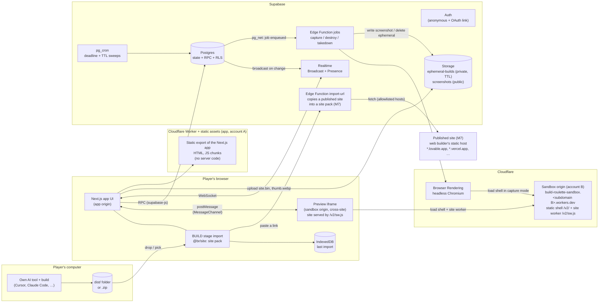
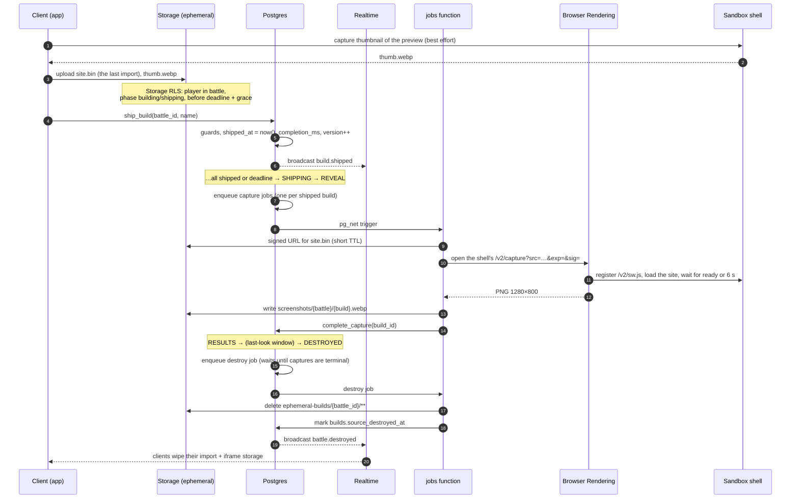

# 1. Production architecture

## 1.1 Principles

These decide most of the trade-offs below.

1. **Builds are temporary, results are permanent.** Imported sites (one site pack each) go
   only into ephemeral storage that has a hard TTL. Permanent storage only holds metadata and
   images.
2. **Postgres is the truth, Realtime is a doorbell.** All game state lives in Postgres rows
   and changes only through transactional RPCs. Realtime messages only tell clients that
   something changed. A client that misses messages can always rebuild its view from one fetch.
3. **Untrusted code never runs on an origin we care about.** User builds run only on a
   separate registrable domain, in sandboxed iframes, and never on the app origin.
4. **The player's device does the heavy work.** Players build on their own computers with
   their own AI tools (M6, [09-import-mode](09-import-mode.md)), and the live preview runs in
   their browser, so the CPU cost grows with players' devices instead of our servers. The only
   server-side execution of user code is the screenshot capture, which runs on an isolated
   managed browser.
5. **No servers we run ourselves in v1.** Supabase and Cloudflare, nothing else. No
   game server process, no WebSocket fleet, no Kubernetes. Timers are enforced from data,
   not by in-memory loops.
6. **Zero-setup onboarding.** Open a link, type a name, play. Auth is anonymous by default
   and can be upgraded to a real account later. Building needs the player's own tools; the
   game itself needs nothing installed.

## 1.2 System diagram



## 1.3 Components

### Web app: a static Next.js export on Cloudflare (a Worker's static assets)
The app is written with Next.js (App Router) and exported as static files
(`output: 'export'`), served as the **static assets of a Cloudflare Worker** on
`build-roulette-web.<subdomain A>.workers.dev` (T-043; Cloudflare Pages from T-037 until
`*.pages.dev` turned out to be blocked in Turkey, [08-free-tier](08-free-tier.md) §2.7). No
server code runs for the app's pages: every page is a file, and every piece of data is loaded
in the browser from Supabase with the visitor's own credentials (the anon key, a player's
anonymous session, a moderator's session). Requests for static files are free, unlimited and
invoke no Worker; the Worker's own code runs only for `/battles/*` (link previews, T-038).

How it got here: the first plan was Next.js on Cloudflare Workers through OpenNext
(T-012: GO with caveats, on Workers Paid). The user then chose free plans only, and T-033
measured that Next.js renders cost 20–45 ms of CPU warm and 250–370 ms in a fresh isolate
against Workers Free's 10 ms ([08-free-tier](08-free-tier.md) §1), so the user picked the
static site ([08-free-tier](08-free-tier.md) §2).

| Route | Rendering | Purpose |
|---|---|---|
| `/` | static file + client | Landing page, "Create room", "Join with code" |
| `/play`, `/try` | static file + client-heavy | Solo game; `/try` imports a built site (or a published link) and runs it without a game (the practice step; `/playground`, the old editor page, redirects to it) |
| `/r/[code]` | one static shell for every room (a `_redirects` rewrite `/r/:code → /r`; the code is read in the browser) | Room: lobby, spin, BUILD (import), reveal, vote, results |
| `/battles/[id]` | one static shell (rewrite `/battles/:id → /battles`); `get_public_battle` in the browser on every load | Permanent results page (shareable). Reads only persisted data. The Worker (T-038; a Pages Function until T-043) serves the shell with each battle's own `og:*` tags and a real 404 for an unknown battle |
| `/u/[id]` | one static shell (rewrite `/u/:id → /u`); `get_player_history` in the browser | Player history (builds, awards), paginated in the query string |
| `/admin` | static file + client; the moderator's own Supabase session | Moderation, event logs, Health (`is_admin()` in every admin RPC) |

**No cache to manage.** The public pages read the database on every load, so a takedown
(from `/admin` or with SQL) shows on the next load; T-026's ISR and its revalidation are gone
with the server. `_redirects` and `_headers` (rewrites, the CSP and the other security
headers, a year's cache for hashed assets) are written at build time
(`apps/web/src/lib/hosting/`); the setup is in `apps/web/DEPLOY.md`.

Game logic lives in Postgres functions, so there is a single transactional authority, and the
web app has no server to keep thin. Anything that needs a secret the browser can't hold
lives elsewhere: Turnstile verification in Supabase Auth, screenshots and destroys in the
capture worker. The same goes for what a browser may not do: reading another site's files
(CORS) for an import from a link happens in the `import-url` Edge Function (M7). Per-battle
link previews are the one piece of code at the edge (T-038).

### Supabase
- **Auth:** anonymous sign-ins, protected by Cloudflare Turnstile. A player can link GitHub
  or Google later to claim their history across devices.
- **Postgres:** all game state. Every mutation goes through `SECURITY DEFINER` RPCs that
  check guards, take row locks, bump a `version` and append to `battle_events`.
  Clients have no direct INSERT/UPDATE/DELETE rights. See [05-database](05-database.md).
- **Realtime:**
  - **Broadcast**, on private channel `battle:{id}`, is fired from Postgres triggers
    (`realtime.send` / `realtime.broadcast_changes`) when a battle, player or build row
    changes. The payload is `{type, version}` plus small fields. Clients refetch if they
    detect a gap.
  - **Presence**, on the room channel, carries online status and the BUILD activity
    `{imported, imports}` (a site is imported, how many imports so far; docs/09 §9.5). None
    of this is persisted.
  - Broadcast is preferred over Postgres Changes because it scales better (no per-subscriber
    RLS evaluation per change) and lets us decide the payload shape ourselves.
- **Storage:**
  - `ephemeral-builds` is a private bucket. Path: `{battle_id}/{user_id}/{file}`. It holds
    exactly three names: `autosave/site.bin` (every import during BUILD, what the deadline
    auto-ships), `site.bin` (SHIP) and `thumb.webp` (the client thumbnail). A site pack is at
    most 5 MB. Every object is deleted by DESTROY, and a hard TTL sweep removes anything older
    than 24 h.
  - `screenshots` is a public bucket with unguessable paths `{battle_id}/{build_id}.webp`.
    It is written only by the service role. This is the only permanent binary data.
- **Edge Functions:**
  - `jobs` (T-034) takes capture, destroy and takedown jobs from the Postgres `jobs` table.
    pg_cron calls it through `pg_net` every minute while a job is due; failed jobs are retried
    with backoff.
  - `import-url` (T-051, M7, [10-url-import](10-url-import.md)) copies a player's published
    site from its link into a site pack and returns it; it stores nothing. Only signed-in users
    (anonymous sessions too) may call it (in a browser, only from the app's origins), at most
    20 links per 10 minutes (`claim_import_url()`). It fetches only `https:` subdomains of an
    allowlist of static hosts (`*.lovable.app`, `*.netlify.app`, `*.vercel.app`,
    `*.github.io`, …), re-checks every redirect and file, and stops at the pack limits (5 MB,
    300 files) and 45 s.
- **pg_cron:**
  - `sweep_deadlines()` every few seconds advances any battle whose `phase_ends_at` has
    passed (this is the backstop, because clients normally nudge first).
  - `sweep_jobs()` every 30 s retries jobs.
  - `sweep_ttl()` every 10 min destroys anything past its hard TTL and orphaned objects.

### Cloudflare
- **Sandbox origin**, in two stages:
  - **Stage 1 (launch):** the shell is a Cloudflare Worker with static assets at a free
    `workers.dev` address, `build-roulette-sandbox.<subdomain B>.workers.dev`, on a **second
    Cloudflare account (B)** (T-043; a Pages project on `*.pages.dev` before, blocked in
    Turkey). The Public Suffix List lists `workers.dev` but not `*.workers.dev`, so a site is
    `<account subdomain>.workers.dev`, and each account has its own subdomain: the app's
    Worker on account A and the shell's on account B are different *sites*, with no second
    domain to buy (two Workers of one account would be one site; the deploy refuses that).
    All builds share this one origin, so cross-build storage isolation relies on the
    shell's full storage wipe on every load and reset (T-009).
  - **Stage 2 (growth):** our own usercontent domain with wildcard DNS and TLS, one
    subdomain per build (`{build_id}.<usercontent-domain>`), and a Public Suffix List entry
    so every build is its own site (security finding F1).
- **Site worker:** the shell (`/v2/`) registers a Service Worker, `/v2/sw.js`, with scope
  `/`. It serves each imported site as a static host would (root-relative URLs, lazy chunks,
  `fetch('/data.json')`, an SPA fallback to `index.html`), so a built site runs unchanged
  ([09-import-mode](09-import-mode.md) §9.3, [03-sandbox](03-sandbox.md) §3.9).
- **No package CDN (M6).** A built site carries its own packages. `@br/pkg-cdn` and the
  esm.sh settings were removed with the editor and the bundler; a site may still load scripts
  from public CDNs itself (the site CSP allows `https:`).
- **Browser Rendering:** headless Chromium, called over its REST API by the `jobs` Edge
  Function. It opens the shell's capture page for a shipped site pack, the page loads the site
  through the same site worker, and the function stores the screenshot. User code therefore
  runs on Cloudflare's isolated browser fleet and not on anything we run. The self-hosted
  capture worker (Playwright Chromium) is the equivalent fallback.

### Observability
- Sentry for the app and the self-hosted capture worker. Errors from the runtime shell are
  **user code errors**, so they are counted and shown to the player but not sent to Sentry.
- PostHog for the product funnel (link opened → joined → shipped → voted → rematch) and
  sandbox health (preview crashes, stalls, restarts).
- `battle_events` is an append-only log of every transition, so stuck battles can be
  debugged and timelines replayed.

## 1.4 What runs where

This is the most important boundary in the system. Anything in the left column is
untrusted. The client can lie, so the server never trusts client-reported times,
results or votes.

| Concern | Client (app origin) | Server (Supabase / Cloudflare) | Sandbox (usercontent origin) |
|---|---|---|---|
| **Identity** | Holds the Supabase session JWT | Issues anonymous/OAuth sessions, enforces RLS | No identity. It never sees the JWT or any cookie for the app. |
| **Game state** | Renders state, predicts countdowns from server timestamps, sends intents via RPC | **Authoritative.** Phase transitions, guards, deadlines, versioning, event log | — |
| **Timers** | Shows countdown using `phase_ends_at` and the measured clock offset. Nudges `advance_battle` when the deadline passes. | Enforces deadlines in RPC guards (`now()` checks) and via the pg_cron sweep | — |
| **Challenge spin** | Plays the spin animation, which lands on the server's result | Picks the cards (weighted random, server-side), writes the `challenges` row | — |
| **Building** | Not in the game: the player's own computer and AI tools, then their project's build (`npm run build`) | — | — |
| **Import** | Reads the dropped `dist/` folder or `.zip`, finds the site root, refuses unbuilt source with a hint, packs it (`@br/site`, ≤ 5 MB, ≤ 300 files). For a link, sends it to `import-url` and takes the pack it returns | `import-url` (M7): copies a published site on an allowlisted host into a site pack (auth, rate limit, same limits); never runs it | — |
| **Import persistence** | IndexedDB (the last import, survives refresh) | `autosave/site.bin` on every import (survives device loss; the deadline auto-ships it) | — |
| **Executing user code** | **Never** | Only in Browser Rendering for screenshots (isolated, vendor-managed) | **Always.** The site worker serves the site; the shell captures console and errors and sends heartbeats |
| **Ship** | Uploads `site.bin` (the last import) and `thumb.webp`, calls `ship_build` | Storage RLS allows uploads only before the deadline. `ship_build` checks phase, deadline and that `site.bin` exists, then stamps `shipped_at` with `now()` | — |
| **Reveal** | Fetches other players' site packs (RLS: battle members only, reveal phase or later) and hands them to the iframe | Controls the spotlight (`reveal_index`) and the reveal order | Runs other players' sites in a fresh frame with origin storage wiped first |
| **Voting** | Ballot UI | `cast_vote` checks eligibility (no self-votes, one per category). Tallies and awards are computed server-side. | — |
| **Screenshots** | Takes a best-effort client thumbnail at ship time (fallback only) | Capture job → headless render of the shipped site pack → `screenshots` bucket | The capture page loads the site through the site worker; the site may signal "ready" |
| **Destroy** | Clears its IndexedDB import and tells iframes to wipe their storage | Deletes the `ephemeral-builds/{battle_id}/` prefix and stamps `source_destroyed_at`. The TTL sweep is the safety net. | Wipes origin storage (the site worker and Cache Storage included) on a `reset` message and on every fresh load |
| **Moderation** | Report button, host kick | Report queue, takedown (deletes the screenshot), rate limits | — |

## 1.5 Key flows

### Join (zero setup)
1. A player opens `https://<app>/r/K7QXM`.
2. If there's no session, the app calls `signInAnonymously()` (with a Turnstile token).
3. The page asks for a display name only, prefilled with a random fun name.
4. `join_room(code, display_name)` runs. The player joins the `battle:{id}` / `room:{id}`
   channel and tracks presence.
5. The page fetches the room snapshot and renders the lobby. Time from link to lobby
   should be under 3 s.

There is nothing to preload for BUILD: the player builds outside the game, and the BUILD
stage is a drop zone plus the preview.

### Import (BUILD)

1. SPIN deals the cards; the countdown starts (10–45 minutes).
2. The player builds with their own tool and runs their project's build.
3. They drop the `dist/` folder (or a `.zip`) on the BUILD stage. The app normalizes the
   paths, finds the site root, refuses unbuilt source with a hint (docs/09 §9.2) and packs
   the site into one `site.bin`. Or (M7) they publish it from their web builder and paste
   the link: the `import-url` Edge Function copies the published site into the same pack
   (docs/10 §10.2–§10.3).
4. The preview runs it at once: the shell hands the files to the site worker and opens a
   fresh frame on `/?__br_site=<id>`. The pack goes up as `autosave/site.bin`, the room sees
   `{imported, imports}` in Presence. Importing again replaces it.

### Ship → capture → destroy



## 1.6 Major decisions

| Decision | Choice | Rejected alternatives and why |
|---|---|---|
| Where players build | On their own computer with their own AI tools; the game imports the built static site (M6, user decision 2026-10-16, [09-import-mode](09-import-mode.md)) | **The in-browser editor + bundler + package CDN** (M1–M5: CodeMirror 6, esbuild-wasm, `@br/pkg-cdn` / esm.sh): vibe coders build with their own agents, and the way each player drives their tool is the game. The editor, the bundler and the CDN were removed in M6. **Importing from a GitHub repository**: later (a repository holds source, and building it needs a build server). A **published link** is imported since M7 ([10-url-import](10-url-import.md)). |
| Sandbox runtime | A cross-site iframe whose shell serves the imported site from a Service Worker (shell v2) | **A blob URL or a `document.write` document**: cannot serve a multi-file site with root-relative URLs, lazy chunks and a client-side router. **WebContainers**: a commercial license, COOP/COEP for the whole app, and a static site needs no Node. **Sandpack**: its preview lives on a third-party origin; we want control over the shell (heartbeat, capture mode, storage wipe). See [03-sandbox](03-sandbox.md) and [09-import-mode](09-import-mode.md) §9.3. |
| Game authority | Postgres RPCs with a version CAS | **A Node game server**: an always-on process we would have to scale and keep available. **Next.js API routes**: no transactional gain, and adds an extra hop. |
| Realtime | Broadcast from DB triggers + Presence | **Postgres Changes**: RLS is evaluated per subscriber per change and doesn't scale as well. **Self-hosted WebSockets**: we'd have to operate them. |
| Timers | Server timestamps + lazy client nudges + pg_cron backstop | **Server `setTimeout`**: we have no persistent server, and it gets lost on deploy. |
| Canonical screenshot | Server-side headless render of the shipped site pack | **Client-only capture**: lower fidelity (DOM-to-canvas misses WebGL, fonts and filters) and can be forged. Clients could upload a fake screenshot as their permanent result. We keep the client thumbnail as a fallback. |
| App hosting | A static export as the static assets of a Cloudflare Worker on `workers.dev` (T-043; on Cloudflare Pages T-037–T-042, until `*.pages.dev` turned out to be blocked in Turkey; user decisions 2026-10-04 and 2026-10-09: Cloudflare, free plans only) | **Next.js on Cloudflare Workers via OpenNext** (T-012, the plan until T-033): every server render is over Workers Free's 10 ms of CPU ([08-free-tier](08-free-tier.md) §1), and Workers Paid is not free. **Vercel**: one more vendor and account, and the user prefers not to use it. **Fly.io (Node)**: not free. |
| Auth | Supabase anonymous, linkable later | **Required sign-up**: kills the "open link, play" moment. |

## 1.7 Cost model (rough estimates; validate in M5)

Assume a battle has 6 players and a 15-minute build (M6: the limits are 10–45 minutes).

| Item | Per battle | Notes |
|---|---|---|
| Building and preview | $0 | Runs on players' own computers and browsers |
| Ephemeral storage | ~6 × (one site pack ≤ 5 MB + a thumbnail), for at most hours | Deleted at DESTROY. Roughly zero storage-month cost. |
| Egress for reveal | ~6 viewers × 6 site packs | The largest variable cost. A pack carries the site's own packages (no shared CDN), so it is larger than the old bundles; to be re-measured with real imports ([07](07-capacity-and-cost.md)). |
| Screenshot renders | 6 × ~5 s of headless browser time | Cents per battle at most |
| Permanent screenshots | 6 × ~150 KB WebP | ~1 MB per battle, forever. Use Supabase image transforms for thumbnails. |
| Realtime | ~6 connections × ~15 min plus a few hundred messages | Activity pulses are throttled to ≤1 per 2 s per player |
| Postgres | A few hundred small writes | Negligible |

Fixed baseline: Supabase (free tier to start, Pro at launch), Cloudflare (Free since the 2026-10-09 decision: the app and the sandbox shell as Workers with static assets on two free accounts, docs/08), plus one domain for the app. The main
things that drive costs up are Realtime concurrent connections and messages (plan limits),
reveal egress, and Browser Rendering minutes. We watch all three from day one.

## 1.8 Repository layout

```
apps/
  web/                 Next.js app, exported as static files (a Cloudflare Worker's static assets)
  sandbox-shell/       Static shell (/v2/), its site worker (/v2/sw.js) and the capture gate Worker
  capture-worker/      The capture/destroy job code: the jobs Edge Function's core and a self-hosted worker
packages/
  runtime/             PreviewHandle: the cross-site preview iframe, bridge and watchdog
  protocol/            Typed postMessage protocol shared by web ↔ shell (zod schemas, versioned)
  site/                The site pack (pack/unpack), the import of a built site (folder or .zip), the copier of a published site and the import-url function's code
  game/                Shared types and pure helpers: phase metadata, countdown math, vote rules
  telemetry/           Error and analytics reporting with scrubbing
  config/              Shared lint and TypeScript settings
supabase/
  migrations/          SQL DDL, RLS, RPCs, triggers, cron
  functions/jobs/      The jobs Edge Function (screenshots, destroys, takedowns)
  functions/import-url/ The import-url Edge Function (a published site → a site pack; bundled from @br/site)
  tests/               pgTAP tests for RPC guards and transitions
tools/loadtest/        The load generator (scripted players)
docs/                  These design docs
```

pnpm workspaces + Turborepo. The rules of the state machine live **only** in SQL. The
`packages/game` package mirrors the read-side metadata (phase names and durations) for UI
and never decides transitions.
