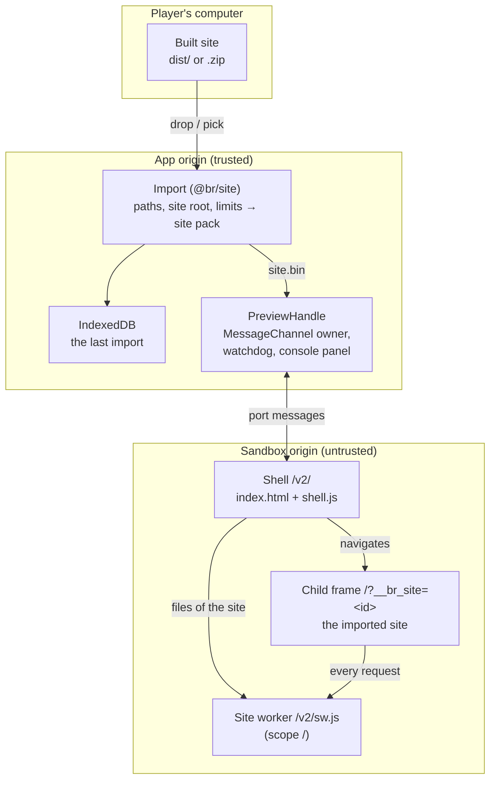
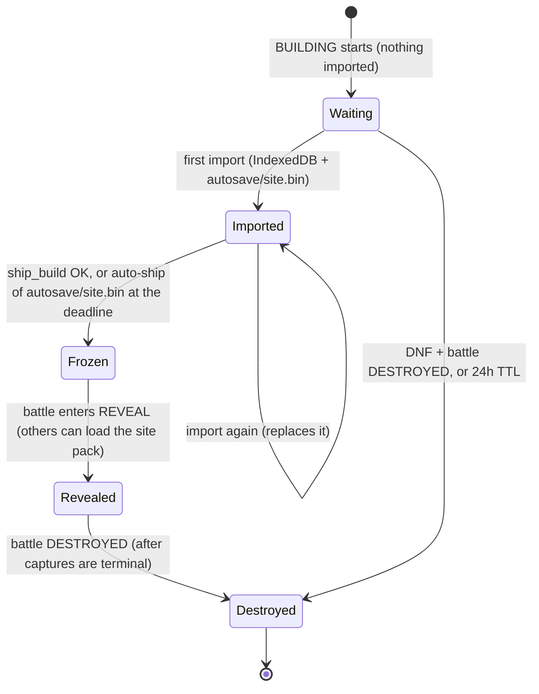

# 3. Disposable sandbox architecture

> **Import mode (M6).** Players build with their own tools and import the built site; the
> sandbox runs that site. [09-import-mode](09-import-mode.md) supersedes this document's
> editing and bundling parts (§3.3 workspace model, §3.4 build pipeline, and the package CDN,
> one-instance and bundler-start sections, now short historical notes). Isolation, the bridge,
> the watchdog, capture and destroy keep their design; what they load changed.

## 3.1 Requirements

**M6 must support:** any **static site** a player's build produces (HTML, JS, CSS, assets;
any framework), running unchanged: multi-file sites with root-relative URLs (Vite's
`/assets/index-abc.js`), lazily loaded chunks, `fetch('/data.json')`, workers, and a
client-side router that expects `location.pathname === '/'`. Browser APIs (Canvas, SVG,
WebAudio, WebGL, `localStorage`, `fetch` to public APIs without keys) as before. Limits: a
site pack of at most 5 MB and 300 files (`SITE_LIMITS`).

**Out of scope:** a site's own server (API routes, server-side rendering), Docker, a shell,
databases, secrets. Building happens outside the game.

**Non-functional:** safe for *viewers* as well as builders. Every copy we hold is destroyable.

## 3.2 Runtime choice

| Option | Pros | Cons | Verdict |
|---|---|---|---|
| **WebContainers** | Real Node, `npm install`, Vite and dev servers | Commercial license for for-profit production use, COOP/COEP for the whole app, heavy boot, limited Safari/mobile support. A static site needs no Node. | No |
| **Sandpack (hosted)** | Very fast to integrate | Preview on a third-party origin: less control over capture mode, storage wipe and heartbeat | No |
| **Custom: esbuild-wasm + ESM CDN + cross-site iframe** | Light, no license, full control | We build and maintain it | **M1–M5.** Removed in M6 with the editor (docs/09) |
| **Custom: cross-site iframe + a Service Worker that serves the imported site** | Runs built sites unchanged (it behaves like a static host); no bundler and no package CDN to run; keeps the M1 isolation, bridge, watchdog and capture | Needs Service Workers in a cross-site iframe and in the capture browser ([02](02-risks.md) R11) | **Chosen (M6)** |

The M1 `SandboxRuntime` interface (boot, writeFile, build, …) went with the bundler. The app
side is `PreviewHandle` in `@br/runtime`; the sandbox side is `apps/sandbox-shell`.

## 3.3 Components

> **Superseded by [09](09-import-mode.md) §9.2–§9.3.** M1–M5 had an editor (CodeMirror 6), a
> workspace in IndexedDB (a file map with a manifest of pinned packages, templates,
> paste-import), and a bundler worker; the bundle loaded its packages from a package CDN
> through an import map. All of it was removed in M6.



## 3.4 Build pipeline

> **Superseded by [09](09-import-mode.md) §9.2.** M1–M5 bundled in the browser: esbuild-wasm
> with plugins for the in-memory files, CDN rewrites of bare imports, CSS and assets, and an
> import map in the shell. Since M6 the player's own build is the pipeline. The game only
> imports its output: it normalizes the paths, ignores what a site never needs
> (`node_modules/`, dotfiles, source maps), finds the site root, recognizes unbuilt source
> and says what to do, checks the limits and packs the files into one `site.bin`.

## 3.5 Preview isolation

```html
<iframe
  src="https://build-roulette-sandbox.<subdomain B>.workers.dev/v2/"
  sandbox="allow-scripts allow-same-origin allow-forms allow-modals allow-pointer-lock allow-popups"
  allow="autoplay; fullscreen; gamepad; clipboard-write"
  referrerpolicy="no-referrer"
  loading="eager">
</iframe>
```

(`live` mode, while a player previews their own import. `reveal` and `capture` drop
`allow-popups`, `allow-modals` and `clipboard-write`, F9 below.)

- **Why `allow-same-origin` is safe here:** the iframe's origin is a *different site*
  from the app. (Stage 1, since T-043: the app is `build-roulette-web.<subdomain A>.workers.dev`
  and the shell `build-roulette-sandbox.<subdomain B>.workers.dev` on a second Cloudflare
  account. The Public Suffix List lists `workers.dev`, not `*.workers.dev`, so the site is
  `<account subdomain>.workers.dev`: only the two accounts make the two sites differ; the
  deploy refuses one account for both.) Same-origin gives the site its own origin, which
  `localStorage`, IndexedDB and the site worker need. Without it the origin is opaque. Do
  **not** add: `allow-top-navigation*`, `allow-popups-to-escape-sandbox`, `allow-downloads`.
- **Per-build subdomain** (stage 2) keeps builds from reading each other's storage. Stage 1
  has one origin and wipes it instead (§3.9).
- **Two policies.** The shell's own documents and every other answer of the static host
  (404s included) get the **shell CSP**; everything the site worker serves for a site gets
  the **site CSP** (`apps/sandbox-shell/src/headers.ts`, the single source of truth).
  - Shell: `default-src 'none'; script-src 'self'; style-src 'self' 'unsafe-inline';
    img-src data: blob:; connect-src 'self' https: wss:; frame-src 'self'; worker-src 'self';
    frame-ancestors <app origins>; base-uri 'none'; form-action 'none'`. The shell runs only
    its own script, fetches `/v2/reset`, registers the site worker, frames the site on its own
    origin and draws thumbnails. A site never runs under this policy.
  - Site: `default-src 'none'; script-src 'self' 'unsafe-inline' 'unsafe-eval' blob: https:;
    style-src 'self' 'unsafe-inline' blob: https:; img-src * data: blob:; font-src * data:;
    media-src * data: blob:; connect-src 'self' https: wss:; worker-src 'self' blob:;
    frame-ancestors 'self' <app origins>; base-uri 'none'; form-action 'none'`. On the capture
    page `frame-ancestors 'self'` only, plus the capture `sandbox` flags.
  - **Why `script-src … https:`, `'unsafe-inline'` and `'unsafe-eval'`:** built sites load
    their own chunks, run inline scripts (theirs, and the injected bootstrap), compile code
    with `new Function` (pixi.js and other engines) and load scripts from CDNs (the Tailwind
    play CDN, unpkg). A build is arbitrary JavaScript already, and `connect-src https:`
    allows `fetch` + `eval` of any script anyway, so this widens nothing.
  - `connect-src https:` is a deliberate choice so builds can call public APIs (for example
    PokéAPI or Open-Meteo). The sandbox holds no secrets, so there is nothing of ours to
    exfiltrate.
  - `worker-src 'self' blob:`: a site's own workers. A site cannot register a Service Worker
    of its own (§3.9 "The site worker").
  - `frame-ancestors` blocks other sites from embedding our sandbox.
  - `form-action 'none'`: a build handles forms in JavaScript; a real submission would
    navigate its own frame or send the fields elsewhere.
  - Other headers on every answer: `Permissions-Policy` (camera, microphone, geolocation,
    payment, USB and the other powerful features off), `Cross-Origin-Resource-Policy:
    same-site`, `Referrer-Policy: no-referrer`, `X-Content-Type-Options: nosniff`,
    `Origin-Agent-Cluster: ?1`; site responses also `Cache-Control: no-store`.
- **Fresh frame per load:** each `load` gets a fresh random site id and a new child frame
  navigated to `/?__br_site=<id>`. Removing the old frame kills every timer and global the
  previous site left behind.
- **Shell versioning:** the shell lives at versioned paths (`/v2/` since M6; `/v1/` was the
  bundle protocol). The protocol version is checked in the handshake.

### Bridge protocol (packages/protocol)
1. The shell loads and posts `{type: 'hello', protocol: 2}` to `parent` with target origin
   = app origin.
2. The app checks `event.origin` against the shell's origin and checks that `event.source` is
   that exact iframe's `contentWindow`. It then transfers a `MessageChannel` port along with
   a random nonce. From then on all traffic uses the port.

| Direction | Message | Purpose |
|---|---|---|
| app → shell | `load {loadId, mode: 'live'|'reveal'|'capture', site}` | Run a site: `site` is the site pack (an `ArrayBuffer`, transferred). The shell unpacks it, hands the files to the site worker and opens a fresh frame on it |
| app → shell | `reset-storage` | Wipe `localStorage`, `sessionStorage`, IndexedDB, Cache Storage and service workers for this origin |
| app → shell | `capture-thumbnail {width, height}` | Best-effort client thumbnail |
| app → shell | `ping` | Watchdog probe |
| shell → app | `ready`, `heartbeat`, `pong` | Liveness and load readiness |
| shell → app | `console {level, args}` (throttled, size-capped) | Console panel |
| shell → app | `runtime-error {message, stack}` | Error overlay (a site that cannot be served is a `module-load` error) |
| shell → app | `thumbnail {webp}` | Fallback screenshot |

Every message is validated with zod on receipt. Unknown or invalid messages are dropped.
Protocol v1's `js`, `css`, `importMap` and `packages` are gone.

### Reloads
Every import (and every restart) is a **full load**: a new site id and a fresh frame.
`localStorage` persists across loads until a reset. In-site navigations and
`location.reload()` stay on the same site (the site worker maps them, §3.9).

### Watchdog
The shell sends a heartbeat every 1 s from the main thread. If heartbeats stop for 5 s
(for example because of an infinite loop), the PreviewHandle removes the iframe, shows
"Build froze", and offers "Restart preview". When building, the player's own preview
also gets a **safe-mode restart**: the next load runs with `requestAnimationFrame` and
timers paused until the user clicks, so a loop that runs on load can't freeze the page
repeatedly.

As built: liveness is a `ping`/`pong` round trip (T-009), a load gets a 15 s grace
(T-027), and since T-031 every limit counts app-awake time only, so a starved app page
doesn't report its own stall as a frozen build. See "Watchdog load grace" and "Watchdog
under starvation" below.

## 3.6 Import lifecycle



| Copy | Location | Created | Destroyed by |
|---|---|---|---|
| The player's project | Their own computer | Before and during BUILD | The player (not ours) |
| Last import | Builder's IndexedDB (app origin) | Every import | Client on `battle.destroyed`, or on next app load (stale-import cleanup by battle id) |
| Autosave | `ephemeral-builds/{battle}/{uid}/autosave/site.bin` | Every import | Destroy job (prefix delete), TTL sweep |
| Shipped artifacts | `ephemeral-builds/{battle}/{uid}/{site.bin, thumb.webp}` | Ship | Destroy job (prefix delete), TTL sweep |
| In-memory site | Viewers' tabs during reveal | REVEAL | Tab navigation, `battle.destroyed` message |
| Sandbox-origin storage | Each viewer's sandbox origin: the site's own storage, and the site worker's Cache Storage (the few most recent sites) | When the site runs | `reset-storage` on every fresh load, before each other build in REVEAL, and on destroy |
| Capture session | Browser Rendering | Capture job | Session closed after each capture |

**Persisted forever:** only the screenshot WebP plus rows in Postgres (challenge, builder,
name, completion time, stats, awards, rank). The `stats` column holds non-code facts:
`{files, bundle_bytes, imports}` since M6 (`bundle_bytes` is the pack size).

## 3.7 Capture mode

Browser Rendering opens the shell's capture page,
`https://<sandbox>/v2/capture?src=<signed site.bin URL>&exp=<unix seconds>&sig=<hmac>`.
The capture page:
- runs only when the `sig` is valid (an HMAC from the jobs function or the capture worker,
  checked by the capture gate on the server, so random people can't use capture mode to
  render arbitrary URLs);
- wipes origin storage, fetches the site pack from the signed URL (short-lived, uncached),
  registers the site worker and loads the site the same way as the preview;
- does not seed or stub `Math.random` or timers, so builds are captured as they really
  behave. The viewport is 1280×800 at DPR 1;
- reports `ready` on `window.buildRoulette.ready()`, or on network idle + 2 s (6 s cap).

The capture side then stores a WebP. Details as built: "Capture mode as implemented" and
"Capture on the free plan" below.

## 3.8 Performance budgets

| Metric | Budget |
|---|---|
| Import (read the folder or `.zip`, pack) and first preview of a typical site | To be set from measurements (M6) |
| Ship (upload the pack + RPC) | < 3 s p95 on a typical connection for a typical site (a 5 MB pack takes longer) |
| Reveal: switch spotlight to next build | < 1 s (prefetch the next site pack) |

The M1–M5 budgets (bundler cold start, rebuild + preview) no longer apply.

## 3.9 Threat model

| Threat | Vector | Mitigation |
|---|---|---|
| Steal viewer's session | Build reads app cookies or storage | Different registrable domain. The JWT never enters the sandbox, and the app never sends it over the port. |
| Tamper with app UI | Build accesses `parent.document` | Cross-origin, so the browser blocks it |
| Fake app messages | Build posts `ship` or `vote` messages to parent | The app doesn't take actions from shell messages. They are display-only (console, errors, liveness). Port and nonce checks plus schema validation. |
| Read other builds' data | Shared `localStorage`, the site worker's cache | Per-build subdomain (stage 2) plus a wipe on every load and before each other build in REVEAL; fresh random site ids ("The site worker" below) |
| Serve another build's content | A build poisons the site worker or its cache for a later build | Random site ids per load, the wipe before each other build, worker scripts only from the network ("The site worker" below) |
| Phishing | Fake "log in" form during reveal | App chrome labels the frame as a user build. Players have no password to type (anonymous/OAuth). Report button. |
| Navigate the viewer away | `top.location = ...` | No `allow-top-navigation` |
| Popup spam | `window.open` loops | Popups stay sandboxed (no escape). Browser popup blocking requires user activation. |
| Freeze or crash tab | Infinite loop, memory bomb | Heartbeat watchdog, one live iframe at a time, Chromium site isolation on desktop |
| Crypto mining | Long-running CPU | Only the spotlighted build runs. Reveal slots are time-boxed. Report button. |
| Hardware access | Camera, mic, geolocation, USB | Permissions-Policy plus `allow=` denylist |
| Abuse capture mode | Use our renderer as an open proxy | HMAC-signed capture URLs. The capture side only renders our own shell. |
| Exfiltrate our secrets | Sandbox calls our APIs | The sandbox has no credentials. Supabase RLS denies the anonymous key on everything relevant. |
| Malicious npm package | Supply-chain code in a dependency | Since M6 a site's packages are part of its build, so they get the same isolation as user code. There is no package CDN and no denylist of ours any more. |
| Embed the shell elsewhere | Third-party site frames our shell | `frame-ancestors` is limited to the app origin |

### The site worker (M6)

Moved here from `apps/sandbox-shell/README.md`, which describes how the worker routes
requests ("The site worker").

Stage 1: every build runs on the one sandbox origin, same-origin with the shell, its child
frame and the site worker. Build code can post to the worker, read and write its Cache
Storage, and unregister it. What it must not be able to do is make the worker serve
attacker content to a **later load of a different build**:

- **Site ids are fresh and random per load** (128 bits). A later load never uses an id a
  build could have known or chosen in advance; content a build stores under an id of its own
  is never navigated to by the shell. An unknown id is a 404, never a fallback.
- **REVEAL wipes the origin before each other player's build**: `resetStorage()` replaces the
  preview iframe (a new shell realm, nothing of the previous build survives in it), and
  `reset-storage` deletes Cache Storage (the worker's cache included), unregisters every
  service worker and fetches `/v2/reset` (`Clear-Site-Data: "cache", "cookies", "storage"`).
  The next load registers the worker again and stores its site anew. The capture page wipes
  first as well.
- **Service worker scripts come only from the network.** A service worker's script (and its
  imports, `updateViaCache: 'none'`) is never fetched through a service worker, and the host
  serves no script but the shell's own: a site that registers `/assets/evil-sw.js` (a file of
  its pack) gets a 404, and the shell's other scripts throw in a worker global (e2e). A site
  may unregister the site worker; that only breaks its own preview until the next load.
- **What a build can still do** (all limited to the same browser partition at the same time,
  which stage 1 already allows in other ways): damage its own site (rewrite its cached
  files, delete the cache, unregister the worker), and, while it keeps running, affect a site
  running *at the same time* in another tab or preview of the same partition: read that
  site's id from the cache and rewrite its files, or upload a site (from an unmapped frame)
  that becomes the "latest" one for the other preview's reloads and in-site navigations.
  Per-build origins (stage 2, finding F1) remove all of it.

This replaces T-032's decision "no Service Worker or Cache Storage on the shell origin"
(below): that decision was about a *shared module cache* that one build could poison for
every build after it. The site worker holds each site under its own random id, and the
origin is wiped before every other build.

**Browser support:** Service Workers in a cross-site iframe work with storage partitioning in
current Chromium, Firefox and Safari; Firefox private windows have none (the preview shows a
`module-load` error; REVEAL falls back to the screenshot). Browser Rendering must run them
for the capture page ([02](02-risks.md) R11).

### Review findings (T-008, code review; fixes tracked as T-009/T-010)

**Design rule: treat the shell as hostile.** The build's frame is same-origin with the
shell, so a build can run code in the shell's realm, use its port, and start a new
handshake. Every message from the sandbox is therefore *display-only and untrusted*:
console, errors, `ready`, `heartbeat` and `storage-reset`. Nothing that matters may
depend on them. In particular:
- capture readiness (M2) is decided by the capture worker, with a fixed wait and a cap.
  A shell `ready` is only a hint;
- destroy never relies on a `storage-reset` acknowledgement;
- once connected, the app ignores a repeated `hello` unless it started the reload itself.

| Threat | Vector | Mitigation |
|---|---|---|
| Builds are same-site with each other | `{build_id}.usercontent` subdomains share a registrable domain, so `Domain=` cookies are shared, a "cookie bomb" can break every preview, and `document.domain` works in some browsers | Add the usercontent apex to the **Public Suffix List** before launch (needs the domain; blocked on the user). Send `Origin-Agent-Cluster: ?1`. |
| Shell-realm persistence | The build installs timers or prototype patches on `parent`, which survive a frame teardown | A real restart recreates the whole preview iframe (new `PreviewHandle`). In production every build has its own shell iframe anyway. |
| App-side flood through the bridge | A hijacked port sends unlimited console messages and the app re-renders on each | Rate-limit and cap in `PreviewHandle`; batch UI updates per animation frame |
| Watchdog spoofing | The port is moved to a worker that keeps sending heartbeats while the main thread loops | Liveness pings must be answered from the main thread. Inherently best-effort; the app stays responsive thanks to site isolation. |
| Incomplete storage wipe | Cookies with other paths or domains, OPFS, Storage Buckets | Use `Clear-Site-Data` from a shell endpoint, plus OPFS and bucket removal |
| Popups outlive the build | `allow-popups` windows keep running and can phish outside the app chrome | No `allow-popups` and no `clipboard-write` in `reveal`/`capture` modes. They are allowed only while building your own app. |
| Headers on other paths | 404s or other paths on the sandbox host have no CSP | Apply the headers to every path. Add `base-uri 'none'`, `form-action` and a fuller Permissions-Policy. |
| Package CDN availability | Big packuments or tarballs, parallel downloads, a disk cache that never evicts | Global limits on downloads and extraction, streaming extraction, a disk quota/LRU, edge rate limits (the package CDN was removed in M6) |

### Mitigation status (T-009, T-010)

| Finding | Status | Verified by |
|---|---|---|
| F1: builds are same-site | **Open**. Needs the Public Suffix List entry (user action). Meanwhile `Origin-Agent-Cluster: ?1` is sent. Until the PSL entry exists, `Clear-Site-Data: "cookies"` clears cookies for the whole usercontent domain. | — |
| F2: re-handshake through the shell realm | Mitigated. One `hello` is accepted per navigation the app starts (attach, mode switch, reset, `restart()`); later ones are ignored and counted. | Unit tests with fake windows |
| F3: shell-realm persistence | Mitigated. `resetStorage()`, a mode switch and `restart()` all replace the whole preview iframe. | Unit + e2e (old element is gone) |
| F4: flood through the bridge | Mitigated. Per-type budgets in `PreviewHandle` (console 100/s, errors 20/s, ready 10/s and only for the current load); retained console capped at 200K chars / 500 entries; web UI batched per animation frame. | Unit tests: 10,000 messages → 1 render |
| F5: package CDN availability | Mitigated (T-010); moot since M6 removed `@br/pkg-cdn`. | (removed with the CDN) |
| F6/F7: incomplete storage wipe | Mitigated. Cookies on every path, domain, `Partitioned` and Cookie Store variant; OPFS, Storage Buckets, Cache Storage, service workers (the site worker included); `/v2/reset` (`/v1/reset` before M6) with `Clear-Site-Data`; reset and load serialized. | e2e: every store empty after reset |
| F8: watchdog spoofing | Partly mitigated. `ping {seq}` / `pong {seq}` answered from a main-thread `setTimeout(0)`; heartbeats no longer count as liveness. Code in the shell realm could still answer from a worker (best-effort, documented). | Fake-timer unit tests + watchdog e2e |
| F9: popups outlive the build | Mitigated. `reveal`/`capture` have no `allow-popups`, `allow-modals` or `clipboard-write`. Flags are set before navigation, and a mode switch means a new iframe. | e2e: `window.open` → null, clipboard rejected |
| I1/I2: headers on other paths | Mitigated. Headers on `/*` including 404s. Adds `Origin-Agent-Cluster`, `base-uri 'none'`, `form-action 'none'` and the extended Permissions-Policy (`bluetooth` left out because Chromium 141 doesn't recognise it). | Unit + e2e, no "Unrecognized feature" warning |
| I3: encoded dot segments | Fixed in the bundler's specifier parser (removed in M6). Since M6 `@br/site` rejects `..`, absolute paths, NUL and control characters in imported paths, and `unpackSite` validates every path. | Unit tests |
| Service worker registration | Before M6: verified blocked. Since M6 the shell registers its own site worker; a site still cannot register one of its own (worker scripts come only from the network, and the host serves no script of a site's pack). §3.9 "The site worker". | e2e |
| CSP inheritance into the build frame | Before M6: a foreign `<script src>` was blocked in the build frame. Since M6 the site CSP allows `https:` scripts on purpose (§3.5). | e2e |

**Current CSP:** the shell and site policies of §3.5 (M6; until then one policy that allowed `blob:` modules and the package CDN).

**Browser caveat:** only Chromium has been tested. Firefox ignores the `Permissions-Policy` header (the iframe `allow` list still works). Storage Buckets and `Origin-Agent-Cluster` are Chromium-only. Safari supports `Clear-Site-Data` only partly.

### Capture mode as implemented (T-013, T-046)

- **URL:** `GET /v2/capture?exp=&src=&sig=` (T-046; `/v1/capture?css=&exp=&map=&src=&sig=`
  with the import map before M6). The HMAC-SHA256 covers
  `br-capture-v2\n<host>\n<path>\n<sorted query without sig>`. `exp` must be at most
  10 minutes ahead. Unknown or repeated parameters are refused.
- **The secret never reaches public JS.** A server-side **capture gate** checks the
  signature: in production it's the shell's Cloudflare Worker (`src/worker.ts`, T-043; a
  Pages `_worker.js` before), run only for `/v2/capture` (`run_worker_first`), with the
  secret stored as a Worker secret; locally the shell's dev server
  runs the same check. Requests failing the check get an empty 403. Because the gate runs
  on the server, nobody can open `/v2/capture?src=<anything>` and get top-level JS on our
  origin.
- **The capture page:** wipes origin storage, then fetches the site pack `no-store`,
  credential-free, with no redirects and at most 5 MB. It registers the site worker, hands
  it the site and runs it in a fresh 1280×800 frame. Its headers are `frame-ancestors
  'none'` and a CSP `sandbox` with the same flags as the `capture` run mode (the site's
  documents get the site CSP with the same `sandbox` flags). The renderer must allow Service
  Workers ([02](02-risks.md) R11).
- **Readiness is decided by the renderer:** the build calls
  `window.buildRoulette.ready()`, *or* the network has been idle for 2 s, with a 6 s cap
  either way. A forged signal can only make the capture earlier.
- **Renderer:** `PlaywrightRenderer` in the self-hosted worker. It allows navigation only to
  the exact capture URL (other navigations get a 204), closes popups, dismisses dialogs and
  enforces a hard timeout. The output is a WebP via sharp. Production on the free plan
  renders through Browser Rendering's REST API instead (T-034, next section); the
  "Worker with a browser binding" plan was dropped (Workers Free's 10 ms CPU, docs/08 §1).
- **Fallback:** if the render fails or is blank (pixel variance check), the client's
  `thumb.webp` is used and marked `fallback`. When neither exists, the result is `failed`.
  A build without `site.bin` (one made before M6) falls back the same way.
- **Destroy worker:** checks the battle is destroyed or abandoned, recursively deletes
  `ephemeral-builds/{battle}/`, re-lists to confirm nothing is left, then calls
  `complete_destroy`.
- **Stage-1 domains:** with the sandbox on a single origin
  (`build-roulette-sandbox.<subdomain B>.workers.dev` since T-043), every build
  shares one capture origin. Isolation then relies on the storage wipe before each run.
  Per-build origins come with the stage-2 domain.

### Capture on the free plan: Browser Rendering's REST API (T-034)

The `jobs` Supabase Edge Function (docs/08-free-tier.md §5) captures with one
`POST …/browser-rendering/snapshot` per build. It sends the signed capture URL at 1280×800
DPR 1, `waitForSelector: html[data-br-capture]` with a **6 s** timeout plus `bestAttempt`
(this timeout **is the cap**), `actionTimeout` 10 s, and a WebP at quality 70 (82 until T-036;
docs/08 §6.3). `/snapshot`
returns the screenshot and the page's HTML from the same session, so the capture page
reports on `<html>`:

| Attribute | Set by | Meaning |
|---|---|---|
| `data-br-capture-page` | the gate's HTML (`CAPTURE_HTML`) | the gate served the page (absent: a 403 or no page → `shell-refused`) |
| `data-br-capture="ready"` | `buildRoulette.ready()` | shoot now (the selector matches at once) |
| `data-br-capture="failed"` + `data-br-capture-error` | `capture.js` when it cannot run the site (a pack that does not unpack, no Service Worker) | render failure → client thumbnail |
| `data-br-paint` = `content` / `empty` | `capture.js` every 250 ms and at the ready signal (`paint.ts`) | `empty`: nothing in the build's frame paints → blank → client thumbnail |

The function cannot decode WebP (no sharp in Deno), so `data-br-paint` takes over from the
worker's pixel check. It looks for visible elements in the viewport that paint: text,
replaced elements, a background, a border, a shadow, an outline or a pseudo-element with
content. A background image on `html`/`body` also counts; a plain background colour does
not (a single flat colour is blank, as with pixels). Like the console hints, the attributes
come from a realm the build controls. That is acceptable for the same reason: a build can
only make its own capture earlier, blank or thumbnail-based.

**Compared with `PlaywrightRenderer`:**

- no "network idle + 2 s" (a build without the ready signal waits the full 6 s);
- no navigation guard (the CSP `sandbox` still blocks popups, modals and downloads);
- blank detection by DOM rather than pixels.

Locally and in tests, `apps/capture-worker/src/stand-in.ts` implements that REST subset on
`PlaywrightRenderer.session()` with the guard off, like the real service.

### Watchdog load grace (T-027)

A `load` blocks the shell's main thread for two long tasks: swapping the frame, then
evaluating the whole module graph. The build's frame shares that thread with the shell,
because they're same-origin. Under CPU contention these tasks can exceed the 5 s pong
limit, so the old watchdog reported a crash for a slow but finite load.

- **The grace window:** when the app sends `load`, `PreviewHandle` opens a 15 s window in
  which up to 15 s of silence is tolerated. `ready` for that load can only *shorten* the
  window, to 5 s after `ready`.
- **Why the sandbox can't abuse it:** only the app's own sends open or move the window, so
  the sandbox can't extend it. Total silence never exceeds 15 s (of app-awake time since
  T-031).
- **Detection bounds:**
  - a loop after `ready` is still caught in about 4–5.25 s;
  - a loop during the load (at a module's top level) is caught within about 15.25 s of the
    load. That's the accepted trade-off.
- `crash` events now carry `phase` (`connecting` | `loading` | `running`).


### Watchdog under starvation (T-031)

T-027's grace covers a load. The same false crash also happened **after** `ready`: in chaos
shard 1 (6 browsers on 4 CPUs) one player's preview reported `heartbeat-timeout
silentMs=5309 phase=running` at the start of BUILD, with no loop in the build.

- **Root cause:** silence was measured on the wall clock (`now - lastPongAt`). While the app
  page itself gets no CPU (a starved machine), or runs a long task of its own, it can neither
  send pings nor receive pongs. When it resumes, the first watchdog tick counts the app's own
  stall as the frame's silence. A real loop in a site-isolated frame doesn't delay the app's
  timers, so the two can be told apart from the app side.
- **Evidence in the failure artifacts:**
  - the crash was already on screen 6.4 s after BUILD started; that player's first build took
    2349 ms (about 150 ms normally);
  - her page's DevTools events stopped: the `building` broadcast that the other five pages
    logged at 50.38 s reached hers at 54.30 s, and four presence messages the others got one
    second apart arrived within 8 ms at 55.39 s;
  - her page sent no screencast frame for 9.5 s (two 4.8 s gaps), the longest of the six
    (the others: 1.5–2.8 s gaps).
  - So her app page's own main thread did not run for about 5 s. The crash measured that.
- **Reproduced** (`packages/runtime/e2e/watchdog-starvation.spec.ts`), both with a calm build:
  - every renderer process of the browser stopped (SIGSTOP) for 7 s, with the app page and
    the frame CPU-throttled x6: the old watchdog reported `heartbeat-timeout`, silence
    7.3 s, phase `running`;
  - both throttled pages blocked by overlapping long tasks (app 6.5 s, frame 7.5 s): silence
    6.0 s, phase `running`.
- **Fix: app-awake time.** Every watchdog limit (the 5 s heartbeat limit, the 15 s load grace,
  the 10 s handshake timeout) is measured on an **app-awake clock**. The 250 ms watchdog tick
  advances it by at most one interval plus 50 ms of timer jitter per run (a busy page runs its
  timers a few tens of ms late, which must not slow loop detection). A tick that runs later
  shows that the app's own timers were stalled, and the stall is not counted. Events between ticks (a pong, `ready`, a
  `load` send) read the clock capped the same way, so it never runs backwards. While the
  app's timers run on time, awake time equals wall-clock time, and nothing changes.
- **Bounds** (awake time; wall-clock time is longer by however long the app was stalled):
  - a loop after `ready` is caught 4.0–5.25 s after it starts, as before. Measured: 4.3–4.8 s.
    With a 3 s whole-browser stop inside the silence: 5.0–5.2 s awake, 7.1–7.5 s wall;
  - a loop during the load is caught within 15.25 s of the send (T-027's bound);
  - a handshake is given up after 10 s;
  - **hidden tabs are unchanged:** no check while hidden, and a fresh 5 s when the tab
    becomes visible. Hidden time is neither awake time nor a stall;
  - any stall of the app's own timers is tolerated, however long. A build that doesn't answer
    for 5 s while the app *is* awake is still a crash, because that's indistinguishable from
    a loop (for example, a frame that is far more starved than the app);
  - under continuous starvation each late tick counts 300 ms only. If every tick runs 1.25 s
    late (one tick per 1.5 s), 5 s of awake time is 25 s of wall-clock time. A real loop is
    caught that much later. That's accepted: the tab itself is that slow meanwhile.
- **Trust:** only the app's own timers advance the clock; nothing the sandbox sends does. A
  build could delay the app's timers only by keeping the app busy (message floods are
  budgeted, F4) or by starving the whole CPU. A hostile build can already answer pings from a
  worker (F8), so this adds no new capability.
- **`crash` events carry the evidence:** `silentForMs` (awake), `wallSilentForMs`,
  `stalledMs` (the difference) and `longestStallMs`. `PreviewStats` counts app stalls of
  1 s or more (`stalls`, `stallMs`, `longestStallMs`) and `sparedSilences`: silences the old
  wall-clock rule would have reported as a crash, which then ended with a pong.
- **Sandbox health telemetry** (`apps/web/src/lib/telemetry/sandbox-health.ts`):
  - every crash is a `preview_crash` analytics event: reason, phase, `silent_ms`,
    `wall_silent_ms`, `stalled_ms`, `longest_stall_ms`, `mode` (`live` while building,
    `reveal` for a spotlight or the last look) and `restarted`. It's sent once that outcome
    is known: Restart preview / Run it again, the preview going away, or `pagehide`;
  - the battle's `sync_health` adds this tab's `preview_crashes`, `preview_restarts`,
    `preview_stalls`, `preview_stall_ms` and `preview_spared`;
  - T-030 rules apply: only the battle's UUID, enums and numbers; no code, console or names;
    nothing without the PostHog key or with DNT/GPC.
  - `preview_spared` counts the false crashes the fix avoided. A crash with a large
    `stalled_ms` or `longest_stall_ms` happened on a starved tab and deserves a look.


### Package cache and CDN outages (T-032): historical

> **Superseded by M6.** The template's packages (React) were warmed into the browser's HTTP
> cache in the lobby and during SPIN, so a package CDN outage did not stop a battle; a
> package the browser never loaded failed fast with "Package server unreachable". T-032
> decided against a Service Worker cache on the shell origin, because a shared module cache
> could let one build poison React for every build after it. Since M6 a built site carries
> its own packages, there is no package CDN, and the shell's Service Worker holds each site
> under its own random id (§3.9 "The site worker").

### The package CDN: esm.sh on the free plan (T-035): historical

> **Removed in M6.** Production on the free plan loaded packages from the public esm.sh
> (our own `@br/pkg-cdn` would have needed Cloudflare Containers); `@br/pkg-cdn` ran locally,
> in the tests and in the compatibility suite. The CDN was one base URL in the app, the shell
> and the capture settings (`NEXT_PUBLIC_PKG_CDN_URL`, `BR_PKG_CDN_URL`, `PKG_CDN_URL`). The
> code, the settings and the CI jobs are gone; the deploy deletes the leftover function
> secret and warns about the variable.

### One instance per package and a fully pinned template (T-040): historical

> **Removed in M6.** esm.sh imports a package's own dependencies by range, which gave two
> copies of a package (two chart.js under react-chartjs-2, two three under fiber). T-040 made
> every manifest package external in every other package's URL and pinned each one once in
> the import map. A built site bundles its own dependencies, so the problem does not arise.

### Bundler start: stall timeout and retry (T-039, T-041): historical

> **Removed in M6.** The bundler worker downloaded and compiled `esbuild.wasm` (13.6 MB) at
> the start of BUILD. T-039 stopped a download that stalled (15 s without progress, one
> automatic retry, then "Couldn't start the bundler" with Retry); T-041 gave the compile
> stage its own 60 s limit and counted both limits in page-awake time, after CI saw a start
> take up to 12.8 s on a starved runner. Since M6 there is no bundler to start.
